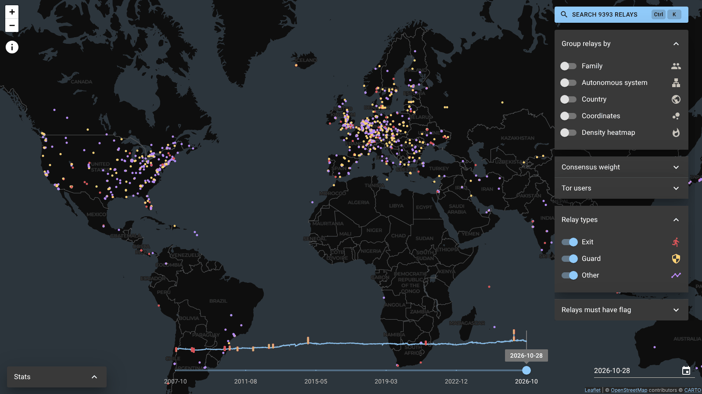

  

  <h1>TorMap</h1>

  
Explore the Tor network on a world map, for any day since October 2007.

  

    <a href="https://tormap.org"><b>tormap.org</b></a> ·
    <a href="https://github.com/TorMap/tormap/releases">Releases</a> ·
    <a href="https://hub.docker.com/u/tormap">Docker Hub</a>
  

  

    
    
    
    
  

TorMap shows where the thousands of public Tor relays are hosted. The backend processes the descriptors from the
[Tor Project archive](https://metrics.torproject.org/collector/archive/), looks up each relay's location and autonomous
system, and serves the result to a web map.

## Features

- **The whole history:** pick any day since October 2007, or follow the number of relays over time on the timeline.
- **Grouping:** group relays by family, autonomous system (AS), country or coordinates, or show a density heatmap.
- **Filters:** show exit, guard or other relays, require relay flags, or only show the relays with the highest consensus weight.
- **Tor users per country:** color countries by the estimated number of Tor users on that day.
- **Relay details:** search any relay and see its descriptor data, AS and confirmed family members.

## Self-hosting

Prebuilt images for the [backend](https://hub.docker.com/r/tormap/backend) and the
[frontend](https://hub.docker.com/r/tormap/frontend) are on Docker Hub, together with an example
[`docker-compose.yml`](backend/docker-compose.yml). The backend needs about 50 GB of disk space and several hours for
the first import. See the [backend deployment guide](backend/README.md#deploy) for the reverse proxy and configuration.

## Development

The backend is written in Kotlin (Spring Boot, PostgreSQL), the frontend in TypeScript (React, Leaflet). Each part has
its own setup guide: [backend](backend/README.md) and [frontend](frontend/README.md).

## Contributing

Bug reports, ideas and pull requests are welcome in the [issues](https://github.com/TorMap/tormap/issues).
Please keep pull requests small and use [Conventional Commit](https://www.conventionalcommits.org/) titles, see
[AGENTS.md](AGENTS.md) for the project rules. To report a vulnerability, follow [SECURITY.md](SECURITY.md) instead.

## Releases

We use [Semantic Versioning](https://semver.org/) and keep the frontend, backend, GitHub and Docker tags in sync.

## Support

TorMap is free, open source and has no ads. If it is useful to you, you can help cover costs via
[GitHub Sponsors](https://github.com/sponsors/JuliusHenke).

## Credits

TorMap is maintained by [Julius Henke](https://github.com/JuliusHenke). Tim Kilb and Julius Henke initially developed
it at the [Technical University of Darmstadt](https://www.tu-darmstadt.de/) as part of the
[PANDA project](https://panda-projekt.de/). Felix Krauspe provides hosting.

It uses relay descriptors and user estimates from the [Tor Project](https://metrics.torproject.org/), IP geolocation
data by [DB-IP](https://db-ip.com), autonomous system data by [MaxMind](https://www.maxmind.com/), map tiles by
[CARTO](https://carto.com/) and [OpenStreetMap](https://www.openstreetmap.org/copyright) contributors, and country
borders from [geojson-maps](https://geojson-maps.ash.ms/).

## License

[GPL-3.0](LICENSE.txt)
